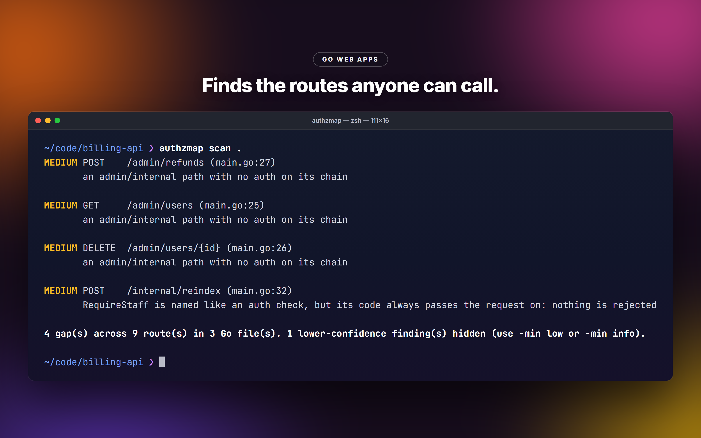
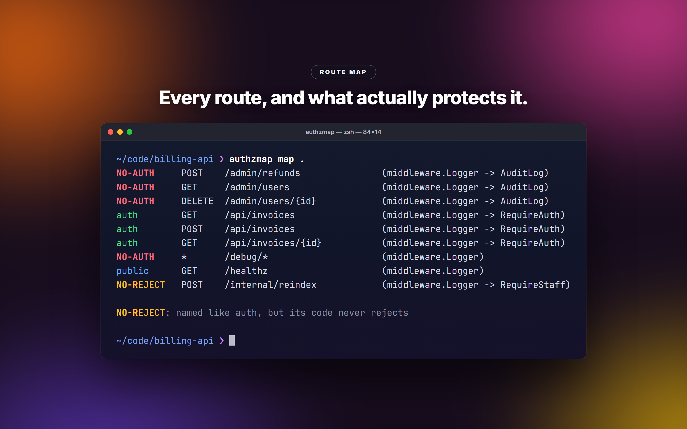
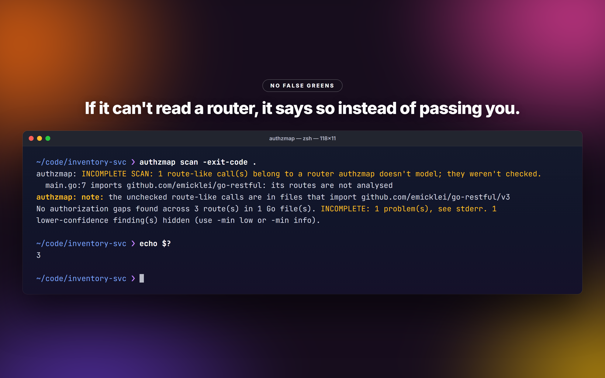

# authzmap

Finds the HTTP routes in a Go service that anyone can call: every route, the middleware in front of it, and whether that middleware really rejects anyone.



Broken access control is at the top of the OWASP list, and it's the class generic SAST can't see. Whether a route may skip auth depends on the rest of the codebase: a handler that forgets the middleware its neighbours all use looks fine to grep and to a linter. authzmap reads the source (it doesn't build or run anything), maps each route to its middleware chain, and flags the routes no auth check reaches.

## Install

```
go install github.com/NotChaosuu/authzmap/cmd/authzmap@latest
```

Building needs Go 1.26 or newer. authzmap parses with the Go it was built with, so build it with the newest Go you have: an older build can't read newer syntax, and says so.

## Quick start

```
authzmap scan ./...    # the routes reachable without auth
authzmap map ./...     # every route and what protects it
```

`scan` on a small billing service:

```
$ authzmap scan .
MEDIUM POST    /admin/refunds (main.go:27)
       an admin/internal path with no auth on its chain

MEDIUM GET     /admin/users (main.go:25)
       an admin/internal path with no auth on its chain

MEDIUM DELETE  /admin/users/{id} (main.go:26)
       an admin/internal path with no auth on its chain

MEDIUM POST    /internal/reindex (main.go:32)
       RequireStaff is named like an auth check, but its code always passes the request on: nothing is rejected

4 gap(s) across 9 route(s) in 3 Go file(s). 1 lower-confidence finding(s) hidden (use -min low or -min info).
```

`map` on the same service:

```
$ authzmap map .
NO-AUTH     POST    /admin/refunds               (middleware.Logger -> AuditLog)
NO-AUTH     GET     /admin/users                 (middleware.Logger -> AuditLog)
NO-AUTH     DELETE  /admin/users/{id}            (middleware.Logger -> AuditLog)
auth        GET     /api/invoices                (middleware.Logger -> RequireAuth)
auth        POST    /api/invoices                (middleware.Logger -> RequireAuth)
auth        GET     /api/invoices/{id}           (middleware.Logger -> RequireAuth)
NO-AUTH     *       /debug/*                     (middleware.Logger)
public      GET     /healthz                     (middleware.Logger)
NO-REJECT   POST    /internal/reindex            (middleware.Logger -> RequireStaff)

NO-REJECT: named like auth, but its code never rejects
```



The status column: `auth` (a check rejects anonymous callers), `public` (public by design: login, health, static files), `weak` (only something that may be auth, like a session loader or optional auth), `UNVERIFIED` (named like auth, too branchy to verify), `COND-AUTH` (rejects only in some cases: a setting, a method, a request parameter), `NO-REJECT` (named like auth, but its code never rejects), `NO-AUTH`. A `~` after it marks a partial route: middleware applied where its router came from wasn't traced.

## What it follows

chi, gin, echo, fiber, gorilla/mux, hertz and net/http (including Go 1.22 method patterns). grpc-gateway, gqlgen, connect-rpc and generated OpenAPI servers are found as one mounted handler.

Routers are followed the way the code passes them around: into helper functions, through struct fields and constructors, across packages of the same module, through `Mount`, `http.StripPrefix` sub-muxes, router wrapper types and an app's own router interfaces. Every way to a route is judged on its own: a router mounted open at `/internal` and behind auth at `/admin`, or served open on one port and wrapped in auth on another, is a finding for the open way. Each framework's ordering rules are modelled (gin and echo groups capture middleware at registration, fiber runs in registration order, chi's `With()` covers one route). Handler slices built with `append` and spread, alice and negroni chains, and builders like `chain.ToHandlerFunc(h, mw...)` keep their middleware.

`-types` also type-checks the module, so routers reached any other way are recognised by type and constant paths fold. It needs the module's dependencies to resolve.

Directories named `vendor`, `testdata`, `fixtures`, `mocks`, `testutil` and `testhelpers` are skipped.

## How it decides

A middleware counts as auth by its name, judged on whole words: `RequireAuth`, `JWTAuth`, `RequireRole`, `casbin.Enforce`. Lookalikes don't count: `tokenBucket`, `csrf.Protect`, `authLogger`.

When the middleware is in your code, authzmap reads its body path by path, and the code wins over the name either way:

- a path that rejects on an auth check (a 401, a login redirect, a failed credential or identity check) makes it auth, whatever it's called;
- if every path hands the request on, or the only stops are unrelated (a preflight, a body limit, a rate limiter), it never rejects, whatever it's called. In gin and hertz only `Abort*` stops the chain;
- if the rejection can be skipped by a setting, the method, a request parameter (`?debug=1`), or a local set in a branch (`if r.Header.Get("X-Debug") == "1" { ok = true }`), it's conditional;
- if it has too many branches to read even after merging the ones that can't matter, it's unverified, never trusted by name.

Routes without auth are then ranked:

- **high**: most routes beside it in the same group require auth and this one doesn't.
- **medium**: the same path elsewhere in the app, or another API version of it, requires auth; or its only auth-like middleware is unverified, conditional or never rejects; or it's an admin or internal path, a token, key or password endpoint, a `DELETE`, or a write to an object-scoped path; or it mounts an API server whose operations can't be seen.
- **low**: everything else reachable without auth.

Login, registration, OAuth callbacks, CORS preflight, `GET` on health, docs and static files, and `POST` to a named webhook receiver are public, for those methods only. Nothing under `/admin` or `/internal` is, except its static files. Add your own with `-allow`.

A scan that couldn't read something says so instead of passing quietly. Unparsable files, route-like calls on a router authzmap doesn't model, and recursion it had to cut make the scan INCOMPLETE. Finding no routes at all is "No HTTP routes found", never "no gaps".



## Flags

Flags can go before or after the path.

| Flag | Default | |
|---|---|---|
| `-min high\|medium\|low\|info` | `medium` | lowest confidence to report |
| `-format table\|json` | `table` | `json` has the same header for `scan` and `map` |
| `-allow GLOBS` | | extra public path globs, merged with the defaults; `*` is one segment, `**` any depth |
| `-no-default-allow` | | drop the built-in public allowlist |
| `-auth NAMES` | | middleware to treat as auth (comma-separated; whole reference or its last part) |
| `-not-auth NAMES` | | middleware that isn't auth; a name in both lists is an error |
| `-exit-code` | | set the exit code for CI (below) |
| `-types` | | type-check the target too; needs its dependencies |
| `-v` | | list every unreadable file and untraced registration |

`authzmap version` prints the version.

## Exit codes

| Code | Meaning |
|---|---|
| 0 | done; without `-exit-code`, always 0 after a scan |
| 1 | with `-exit-code`: gaps at or above `-min` |
| 2 | usage error, unreadable path, no Go files |
| 3 | with `-exit-code`: no gaps, but the scan was incomplete or found no routes |

## CI

```yaml
- uses: actions/setup-go@v5
  with:
    go-version: stable
- run: go install github.com/NotChaosuu/authzmap/cmd/authzmap@v1.0.0
- run: authzmap scan -exit-code ./...
```

Use `-min high` to fail only on the strongest signal while you clear the backlog, and `-format json` to feed the findings to something else.

## Known limitations

- It reads code, not runtime behaviour. Auth done by a gateway in front of the service is invisible: pass `-allow "/**"` or `-auth` for that.
- Locals are followed per path only when they hold a constant or a credential read. A token swapped for the result of some other call, or a flag set through a pointer or a struct field, isn't followed.
- Routers it doesn't model (go-restful, goa, beego, iris, httprouter, go-zero, huma, an app's own router wrapper such as gitea's) make the scan incomplete; their routes aren't analysed.
- Wrappers applied inside helper functions are credited only in simple shapes: a function that only wraps its handler, a constructor returning `&http.Server{Handler: RequireAuth(h)}`, a builder whose other arguments are all middleware values. Anything more involved shows the routes as unprotected.
- Handlers that authorize inside their own code in ways it doesn't recognise still show up as gaps, and so do public-by-design routes that don't look public. A finding is a place to look, not a verdict.

## License

MIT

## Author

Chaosuu, t.me/chaosuudev. More tools at github.com/NotChaosuu.
